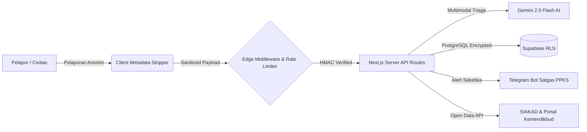

# 🛡️ RuangAman (SafeSpace Campus)
> **Engineering Interconnected Web Solutions to Empower Digital Ecosystems**  
> *Platform Ekosistem Digital Interoperabel, Aman, dan Berbasis AI untuk Pencegahan & Penanganan Kekerasan Seksual di Lingkungan Perguruan Tinggi (Permendikbudristek No. 30/2021).*

---

[](https://nextjs.org/)
[](https://www.typescriptlang.org/)
[](https://tailwindcss.com/)
[](https://supabase.com/)
[](https://ai.google.dev/)
[](/api/openapi)
[](tests/runAllTests.ts)
[](LICENSE)

---

## 📖 Ringkasan Proyek

**RuangAman** adalah platform web modern yang dirancang untuk memutus fenomena gunung es kekerasan seksual di kampus. Platform ini mengintegrasikan **Kecerdasan Buatan Terapan (Multimodal Generative AI)**, **Pertahanan Siber Berlapis (Zero-Knowledge Defense-in-Depth)**, dan **Interoperabilitas Terbuka (Open Data & OpenAPI 3.0)** untuk menghubungkan korban, Satgas PPKS, pimpinan perguruan tinggi, hingga kementerian ke dalam satu ekosistem digital yang tangguh dan terpercaya.

Untuk proposal konseptual mendalam, silakan baca:  
📄 **[Dokumentasi Lengkap & Proposal Proyek (DOKUMENTASI_LENGKAP_PROPOSAL_RUANGAMAN.md)](./DOKUMENTASI_LENGKAP_PROPOSAL_RUANGAMAN.md)**

---

## 🌟 Fitur Utama & Keunggulan

- **🔒 Pelaporan Anonim Kriptografis (Zero-Knowledge):** Tanpa registrasi akun. Identitas pelapor dilindungi sepenuhnya dengan kunci token pelacakan rahasia.
- **🤖 Smart AI Incident Triage (Gemini 2.0 Flash):** Mengklasifikasikan tingkat keparahan kasus (*Critical, High, Medium, Low*), mendeteksi indikator trauma/bahaya diri, serta menyusun rekomendasi taktis bagi Satgas.
- **💬 Asisten Virtual PFA (Ara - Psychological First Aid):** Memberikan pendampingan emosional awal 24/7 dengan protokol *Look, Listen, Link* berstandar WHO.
- **🕵️ Forensik Bukti Digital & Anti-Deepfake:** Pembersihan metadata rahasia (EXIF/GPS stripping) di sisi klien serta deteksi heuristik audio/video hasil rekayasa AI (ElevenLabs Voice Clone & Sora Video).
- **🚨 One-Tap Geolocation SOS:** Panggilan siaga darurat berbasis titik koordinat kampus yang langsung disiarkan ke posko Satgas PPKS.
- **📊 Dasbor Transparansi Publik & Peta Risiko Kampus:** Agregasi data statistik tanpa identitas (CC0) serta visualisasi area kampus yang memerlukan peningkatan fasilitas keamanan.
- **🔌 Interoperabilitas Ekosistem Kampus:** Spesifikasi OpenAPI 3.0.3 (`/api/openapi`) dan endpoint *Open Data* (`/api/v1/open-data/*`) untuk pertukaran data mulus dengan SIAKAD, Smart Campus, dan LLDIKTI.

---

## 🏛️ Arsitektur Sistem & Alur Interkoneksi



---

## 🛡️ Arsitektur Keamanan Siber (Cybersecurity Hardening)

1. **HMAC-SHA256 Token Sesi Admin:** Autentikasi sesi berbasis tanda tangan kriptografi Web Crypto HS256 dalam cookie `HttpOnly`, `SameSite=Lax`, dan `Secure` (kebal pencurian cookie dan XSS).
2. **Sliding-Window Rate Limiting:** Proteksi Anti-DDoS dan brute force berbasis IP pada seluruh endpoint sensitif (login, submit laporan, dan pelacakan).
3. **Pembersihan Metadata Klien (EXIF Scrubbing):** Mencegah kebocoran koordinat GPS rumah/lokasi pelapor sebelum berkas bukti terunggah ke jaringan.
4. **Isolasi Basis Data Row-Level Security (RLS):** Mencegah penghapusan atau manipulasi status laporan oleh pihak luar.

---

## 🧪 Pengujian Otomatis (Automated Testing Suite)

RuangAman dilengkapi dengan pengujian otomatis komprehensif yang menguji aspek keamanan kriptografi, pemulihan rate limiter, dan forensik AI.

Untuk menjalankan pengujian:
```bash
npm test
```

Hasil verifikasi:
```text
====================================================
   RUANGAMAN AUTOMATED TEST & VERIFICATION SUITE    
====================================================

🧪 Starting Security, HMAC-SHA256 Token & Rate Limiter Tests...
  ✅ Admin token successfully created with HS256 signature.
  ✅ Token cryptographically verified (HMAC-SHA256 intact).
  ✅ Tampered token successfully rejected (Signature mismatch detected).
  ✅ Rate limiter correctly throttled excessive requests (429 Protection active).
🛡️ All Security & Cryptographic Token Tests Passed!

🧪 Starting Media Forensic Unit Tests...
✅ Test 1 Passed: AI Video (Sora) correctly flagged as Manipulated.
✅ Test 2 Passed: Clean video stream recognized as Original.
✅ Test 3 Passed: AI Voice (ElevenLabs) correctly flagged as Manipulated.
✅ Test 4 Passed: Clean audio recording recognized as Original.
✅ Test 5 Passed: Video metadata stripping returned cleaned file.
✅ Test 6 Passed: Audio ID3 metadata stripping returned cleaned file.
🎉 All 6 Media Forensic Unit Tests Passed Successfully!

🧪 Starting Report Upload Forensic Integration Tests...
✅ Upload Integration Test Passed: All media files categorized correctly.

====================================================
🎉 100% ALL INTEGRATION & SECURITY TESTS PASSED!    
====================================================
```

---

## 🚀 Memulai Instalasi Lokal (Quick Start)

### 1. Kloning Repositori & Instal Dependensi
```bash
git clone https://github.com/muhzuhri/RuangAman.git
cd RuangAman
npm install
```

### 2. Konfigurasi Environment Variables
Salin file `.env.example` menjadi `.env.local`:
```bash
cp .env.example .env.local
```
Sesuaikan variabel environment:
- `NEXT_PUBLIC_SUPABASE_URL` & `NEXT_PUBLIC_SUPABASE_ANON_KEY`
- `SUPABASE_SERVICE_ROLE_KEY`
- `GEMINI_API_KEY`
- `TELEGRAM_BOT_TOKEN` & `TELEGRAM_CHAT_ID`
- `ADMIN_SESSION_SECRET`

### 3. Jalankan Pengujian
```bash
npm test
```

### 4. Jalankan Server Pengembangan
```bash
npm run dev
```
Buka browser pada [http://localhost:3000](http://localhost:3000).

---

## 📚 Endpoint API & Interoperabilitas
- **Spesifikasi JSON:** `http://localhost:3000/api/openapi`
- **Open Data Agregat:** `http://localhost:3000/api/v1/open-data/statistics`

---

## 👥 Kontributor & Hak Cipta
Dikembangkan dengan dedikasi untuk menciptakan ekosistem pendidikan tinggi Indonesia yang aman, inklusif, dan bebas kekerasan seksual.

*Lisensi MIT - Hak Cipta © 2026 Tim Pengembang RuangAman.*
